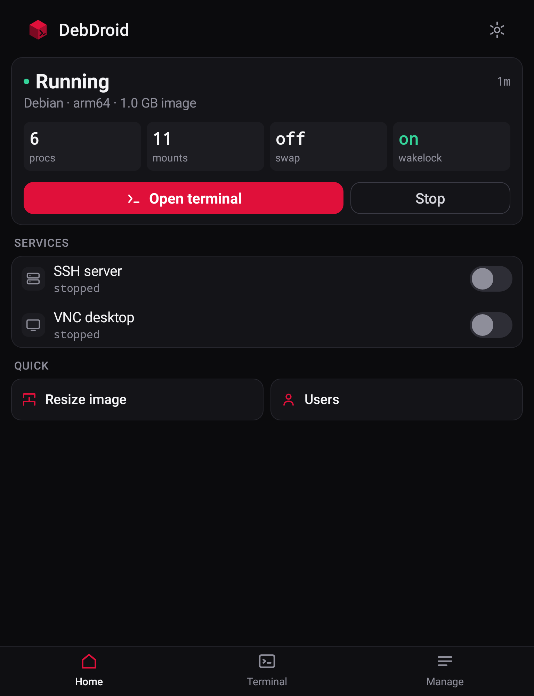
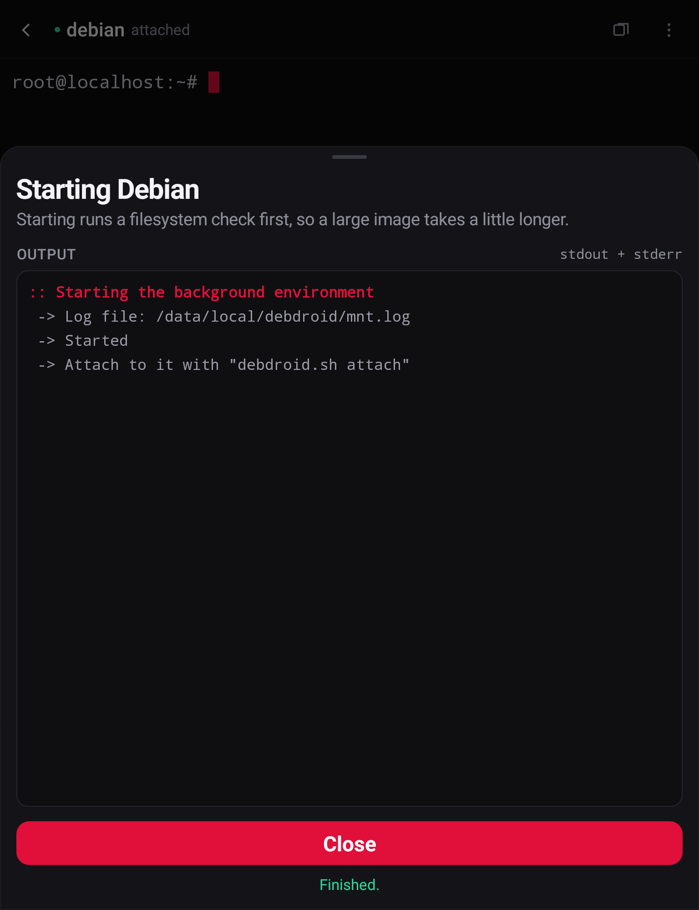
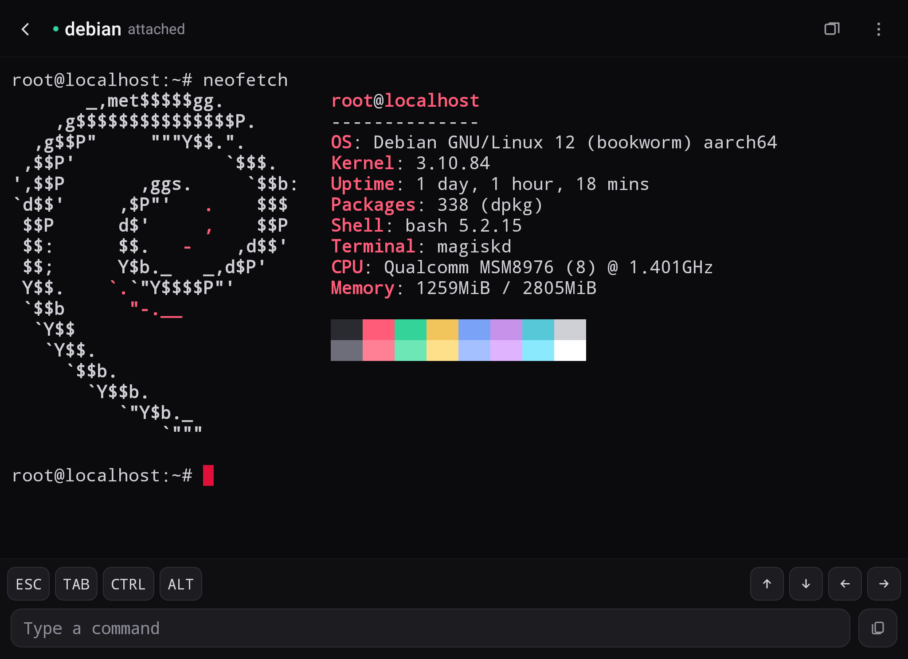
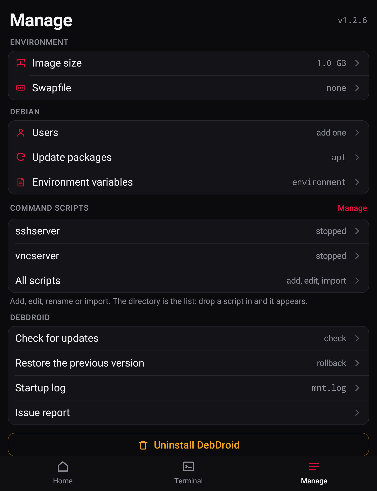
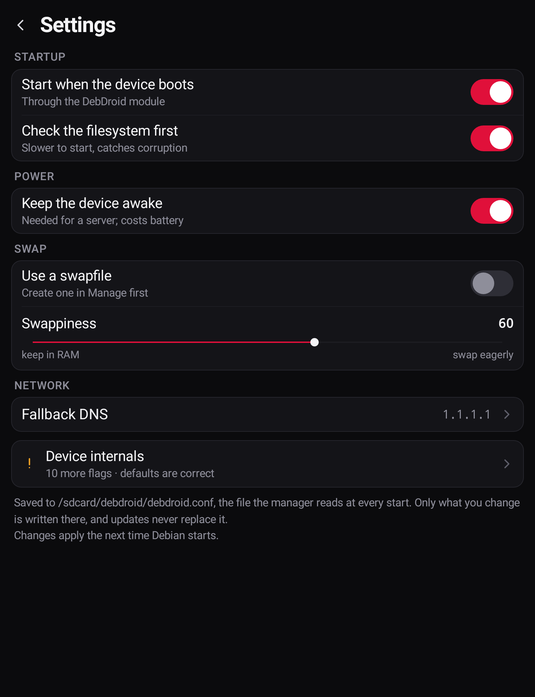

[← Docs](README.md)

# Gallery

Real Debian programs on a phone, unmodified from the Debian archive. The app
shots are from a Galaxy Tab S2 on Android 7. The desktop shots are XFCE4 over
VNC, which [run a desktop](guide/desktop.md) sets up.

## In the app

Home, with Debian running, a session's processes and the switches for the SSH
server and the VNC desktop.

Starting Debian, with the same output the terminal commands print.

The built-in terminal, a shell inside Debian.

Manage and Settings: storage, swap, users, updates and start at boot, without
a command.

[Use the app](guide/app.md) covers all of it.

## In a terminal

`neofetch` reporting Debian, not Android.

## On the desktop

Firefox, with the real Mozilla build from the Debian archive.

Visual Studio Code.

OnlyOffice.

GIMP.

Wireshark, capturing on the phone's own interfaces. This one needs the hardware
access that root buys.

---

Expect this to feel slow on a 2014 phone, and expect a desktop with a browser
to want more RAM than the device has, which is what
[swap](guide/keep-it-running.md) is for.
