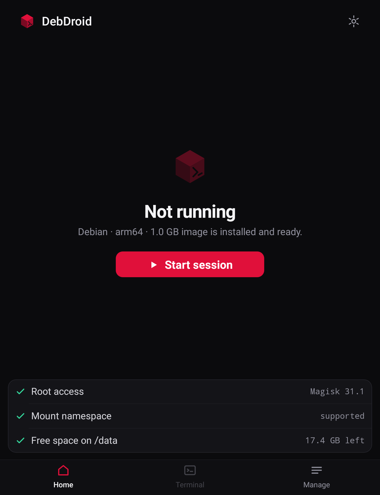
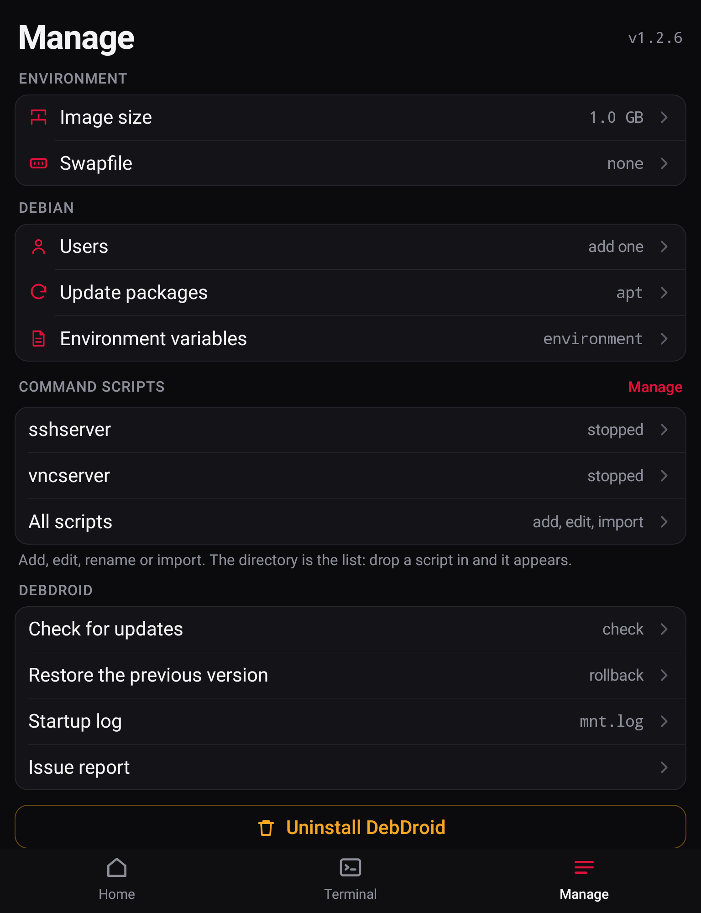
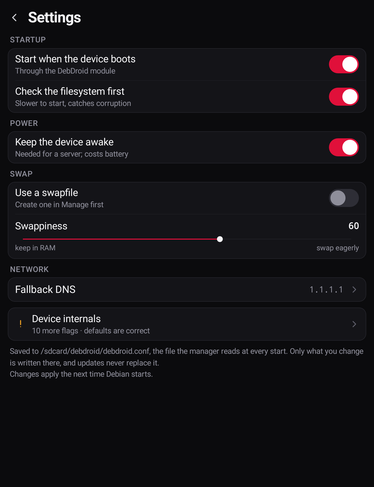

[← Docs](../README.md)

# Use the app

The DebDroid app installs everything and runs Debian from your home screen,
with a terminal built in. You need no terminal app, no file manager and no
commands.

It runs on Android 5.0 and later. The phone still has to be rooted, as with
every other way of installing.

## Install the app

1. Download `DebDroid.apk` from the
   [releases page](https://github.com/NICUP14/DebDroid/releases).
2. Open it. Android asks to allow installs from your browser or file manager
   the first time; allow it, then install.
3. Open **DebDroid**. Your root app (Magisk, KernelSU or APatch) asks whether
   to allow it. Allow it.

## First run

The app checks the phone, then shows what it will do:

- **Install Debian on this device** when nothing is installed yet. Press
  **Install**. It sets up DebDroid and downloads Debian (about 130 MB), so the
  phone needs Wi-Fi for this step. Every download is checked before it is used.
  **Start Debian when the device boots** is ticked; untick it if you would
  rather start it yourself.
- **DebDroid is already on this device** when you installed it before, from
  the module or the terminal, and something needs doing: an update, a missing
  Debian, or tools that cannot run. It says which, with one button. Updating
  keeps your Debian and your settings.

If nothing needs doing, the app opens straight to Home.

> [!TIP]
> No Wi-Fi on the phone? Download `DebDroid-module-offline.zip` on a computer
> and copy it to the phone. On the install screen, choose
> **Use the offline installer instead** and pick that zip. Debian is inside it,
> so nothing is downloaded.

If the zip is not exactly the one DebDroid released, the app tells you and
shows both checksums. It installs it only if you press **Use it anyway**.
That is for your own backups. Do not use it for a file you found somewhere.

## Home

**Start session** starts Debian and keeps it running in the background, even
after you close the app. While it runs, Home shows what is going on inside it,
and switches for the SSH server and the VNC desktop. Turning one on opens it
in the terminal, so you can answer what it asks, such as the desktop's
password the first time. What each
one gives you is in [connect from your computer](remote-access.md) and
[run a desktop](desktop.md).

**Stop** shuts Debian down cleanly and stops everything inside it.

A notification stays while Debian runs, with **Attach** and **Stop** buttons.
On Android 7 and later you can also add the **DebDroid** and **Terminal**
tiles to Quick Settings.

## Terminal

The **Terminal** tab is a shell inside Debian, as root. The row of keys above
the keyboard has Esc, Tab, Ctrl, Alt and the arrows. Ctrl-C stops a running
program, as on a computer.

The button at the top right switches between sessions and opens a new one.
Each session is its own shell.

## Manage

Everything you would otherwise type a command for:

- **Image size** grows the space Debian has. See [manage storage](storage.md).
- **Swapfile** creates one, for when a desktop or a browser runs out of
  memory. Then turn on **Use a swapfile** in Settings. See
  [keep it running](keep-it-running.md).
- **Users** makes your own account, which [first steps](first-steps.md)
  explains.
- **Update packages** runs `apt update` and `apt upgrade`.
- **Environment variables** edits `/sdcard/debdroid/environment`, the
  settings that apply inside Debian.
- **Command scripts** lists the scripts in `/sdcard/debdroid/command`. Run,
  edit or add your own.
- **Check for updates** says whether a newer release is out. To update,
  install the newer `DebDroid.apk` over this one and open it.
- **Restore the previous version**, after an update made with `self-update`.
- **Startup log**, and **Issue report**, which collects what a bug report
  needs.
- **Uninstall DebDroid**. Your Debian is kept unless you turn on **Also delete
  the debian image**, and you type `UNINSTALL` to confirm. The app itself
  stays; uninstall it from Android's settings. See
  [uninstall](uninstalling.md).

## Settings

The gear on Home. **Start when the device boots** and **Keep the device awake**
are the two that matter for a server. The rest have sensible defaults.

Settings are saved to `/sdcard/debdroid/debdroid.conf`, the same file the
terminal commands use, and updates never replace it. They apply the next time
Debian starts.

## The app and the terminal agree

The app runs the same `debdroid.sh` the rest of these guides use. You can
start Debian in the app and attach from a terminal, or the other way round,
and both see the same state. Nothing you learn in one is lost in the other.

---

Next: [first steps](first-steps.md).
